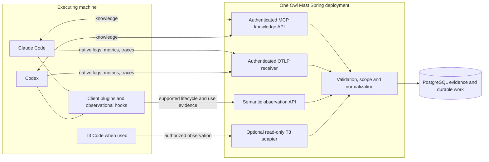

# Native agent integration planning contract

The full native Claude Code and Codex feature set is planned now and delivered in separate epics. Both clients execute on the executing machine and can communicate directly with Owl Mast, whether launched standalone or through T3 Code. T3 is an optional evidence source. This supersedes the earlier proposal to postpone standalone reporting. It preserves the chosen single modular Spring deployment and PostgreSQL-backed work processing.

This companion is a concrete implementation-planning proposal. The user's scope correction is adopted; endpoint spelling, schema details and configuration packaging below are proposed contracts to qualify in the linked stories. The finalized [architecture spine](ARCHITECTURE-SPINE.md) governs shared invariants; endpoint/schema details in this companion remain proposals until their owning qualification stories publish them. Documentation research is not proof of the installed runtime's coverage.

## Communication paths

No intermediary collector, queue service, workflow engine or always-on local daemon is mandatory for these paths. An optional collector with a persistent queue is a later operational response to measured delivery requirements; it is not silently added to the baseline. Native exporters and hooks do not have a demonstrated durable offline backlog guarantee.

## Contracts and ownership

| Boundary | Purpose and owner | Explicit limits |
|---|---|---|
| MCP, proposed `/mcp` | Knowledge module exposes scoped search, exact-version read and supported package retrieval through Spring AI's asynchronous WebFlux transport. | Retrieval is not native skill installation, observed application, useful reuse or general session telemetry. Apply Keycloak authentication and application authorization explicitly. |
| OTLP, proposed `/ingest/otlp/v1/logs`, `/ingest/otlp/v1/metrics`, `/ingest/otlp/v1/traces` | Ingestion module accepts the three standard signals and records sanitized durable receipts before asynchronous normalization. | Spring's ordinary Micrometer/OpenTelemetry configuration exports the application's telemetry; it does not implement these receiver routes. |
| Semantic observation, proposed `/api/v1/observations` | Versioned ingestion contract receives permitted lifecycle, artifact load/application and task-correlation evidence from native hooks/plugins. | Hooks report observations; they must not request agent launch/cancel/retry, shell, merge or deployment authority. Errors cannot silently become successful delivery. |
| Enrollment/configuration | Enrollment module owns stable registered client/device IDs, authorized project bindings, credential references, capabilities and repair/revocation. | A hostname, resettable telemetry installation ID or shared external account is not proof of person, tenant, machine or task identity. |
| Optional T3 reads | Connection adapter imports permitted additional thread/delegation/work context into the same evidence model. | T3 tokens, metrics and native events may overlap. T3 is neither the telemetry gateway nor an authority that bypasses project/source permissions. |

Knowledge owns item/version/evaluation/publication state, its lifecycle lineage, the public MCP discovery/load/package contract and exact-version delivery acknowledgments/receipt records. Retrieval owns rebuildable indexes and query implementation behind that contract. Ingestion owns normalized observation envelopes and transport/source receipts; Evidence owns canonical runs, observed segments, work correlations and typed work/contribution relationships, plus native load/application and verified-reuse assertions referencing Knowledge versions/receipts. Graph/list views project owner-issued relationships without creating another lifecycle authority. Usage owns derived accounting and its basis. Connections own source namespaces, cursor/checkpoint state and permissions evidence. Audit owns the append-linked audit record and query contract; each feature emits its mutation/outcome evidence from its first implementing story. Background-work infrastructure owns leases/retries, not business decisions. Governance owns the recovery quarantine/reconciliation/release contract; protected reads and dispatch consume it, while Access, Knowledge and effect owners provide reconciliation results. E18 verifies this shared contract rather than creating another release authority.

## Client-driven knowledge retrieval

Adopted A-1 on 2026-11-06: the agent decides when to search and which lessons to load. Search returns bounded summaries/metadata and exact-version references; an explicit load fetches only the selected content or requested package files. Paginate/bound responses and expose continuation or truncation without disclosing hidden matches. No session-start, turn, knowledge-change or work-update event automatically injects full lessons/history into agent context. Work-update push notifications remain a separate product capability.

Validated/approved versions are the default. A client-controlled inclusion flag defaults off; an explicit opt-in can include eligible unvalidated candidates, with validation status, provenance and unresolved conflicts clearly identified. The same choice applies to search, exact-version reads and package access; knowing a version ID or using a cache must not bypass it. The flag cannot widen tenant/project/source permissions or override lifecycle restrictions. Cache eligibility includes the requested mode and current validation/access state. Flag spelling and concrete tool schemas are implementation details of E04's shared contract.

Automated checks may approve an exact version under configured policy; no universal human-review requirement is introduced. Search hits, selected loads, native activation and verified useful reuse remain separate evidence. Retaining full conversations and archives does not automatically make them validated guidance or inject them into context.

## Lineage and withdrawal

Adopted on 2026-11-06: lineage is a first-class contract. Retain exact-version relationships from source evidence (conversation turns/tool results, Jira/Git and other permitted records) to lesson versions, validation decisions, publications, deliveries and observed reuse. Keep derived-from, supersedes, validated-by, published-as, delivered-to and used-in relations distinct, with source-qualified IDs, permitted actor/policy details, source/recorded times and the evidence basis. Unknown lineage remains explicit; a usage edge alone does not prove derivation or useful reuse. Feature owners expose these relationships through their APIs rather than introducing a competing graph authority.

Adopted A-2: withdrawal/quarantine blocks future ordinary retrieval of the affected version and its promoted derivatives, including while asynchronous index/cache cleanup is pending. Use transitive derivation/publication lineage to identify affected versions; mere delivery/use links do not withdraw unrelated work. Keep permitted restricted history and the lineage needed to explain what changed. Explicit client inclusion of unvalidated candidates cannot override withdrawal. Re-publication requires fresh evaluation under current policy.

Archiving changes storage location, not version identity or lineage. Corrections and supersession append relationships instead of silently rewriting prior evidence. Every lineage node/edge, label, count and source reference is checked against current project/source/recipient permissions; a visible publication does not reveal a restricted ancestor. Source access revocation remains distinct from withdrawing an independently authorized publication. Previously delivered external copies cannot be assumed recalled, and protected historical access is not ordinary agent guidance.

Adopted A-4: disabling project promotion stops all new company publications, including queued or in-flight automatic/manual attempts. The publication commit atomically rechecks the current mode and policy. Existing published versions remain available under current audience/access and lifecycle rules until withdrawn, superseded or otherwise ineligible; disabling promotion itself neither withdraws those versions nor removes their lineage.

## Initial personal enrollment boundary

Adopted on 2026-11-06: each native agent enrollment belongs to an individual Owl Mast user; unattended service-identity agent operation is deferred. Keep principal, machine, client, enrollment and session/run identities separate. Shared machines have separate personal enrollments and credentials. Enrollment ownership identifies the responsible person but does not by itself prove who initiated every observed action or resolve imported shared-account activity.

Effective access is bounded by both current personal permissions and the enrollment's project/purpose grants. Owner suspension, enrollment revocation and credential expiry must be enforced on subsequent MCP, hook and OTLP access, without a service-identity fallback. Exact token/delegation/refresh mechanisms remain to qualify per client and transport; browser session lifetime is not silently equated with native enrollment lifetime. Revoking Owl Mast access does not stop an external agent or erase its retained context. This scope decision does not disable internal source synchronization, indexing or other already-selected Spring/PostgreSQL background jobs.

## OTLP receiver behavior

Full conversation capture is the adopted product default as of 2026-11-06: prompts, responses, tool arguments and tool results are captured alongside activity evidence, with project controls to disable or narrow capture. This supersedes the metadata-only/default-off proposal. Secret filtering and current source/project access remain mandatory. Conversation/tool content stays active for 30 days and then moves to retained archive. Archive implementation, other record-class policies and actual-environment permissions/processing destinations require qualification before live use; this document does not enable capture in existing clients.

Native packages must qualify content configuration in both standalone and T3-hosted modes. Preserve source-qualified message/turn/tool identity and content coverage across channels, suppress duplicate messages and distinguish missing, redacted, excluded and truncated content. A default-on setting does not prove complete history arrived. Captured conversations are evidence, not automatically approved skills/memory or company-safe publications; existing knowledge evaluation/publication rules still apply.

The initial proposal is HTTPS with OTLP/HTTP protobuf and JSON, plus uncompressed and gzip requests. gRPC is not required for these clients' documented HTTP paths. Use official signal message definitions; do not invent a lookalike JSON endpoint and call it OTLP.

- Validate credentials and tenant/client binding, content type, compressed and decompressed sizes, schema and allowed content before durable payload storage. Resolve A-3's remaining archive/other-record policies, actual-environment permissions and processing destinations before real customer ingestion. Secret filtering must cover tool arguments/results, resource attributes and exception text as well as prompts/responses.
- Return the signal-specific `ExportLogsServiceResponse`, `ExportMetricsServiceResponse` or `ExportTraceServiceResponse`, encoded consistently with the request. Successful export uses HTTP 200. Acknowledge accepted data only after its sanitized receipt and required processing work are committed.
- Use valid OTLP partial-success responses with rejected record counts when applicable. Clients do not retry partial success. Apply bounded backpressure with protocol-correct responses; use 429/503 and `Retry-After` where appropriate. OTLP's retryable HTTP statuses are 429, 502, 503 and 504; do not assume every 5xx retries.
- Normalize asynchronously through the already-selected PostgreSQL job mechanism. Unknown optional metadata remains unknown; rejected, pending, unsupported and unmapped evidence have distinct visible states. Persist no success claim for data that never arrived.
- Transport retry can duplicate requests. Stable native IDs and source-specific interval/counter identities drive deduplication; hashing equal payloads alone cannot distinguish every legitimate identical event. Maintain an explicit duplicate/ambiguity policy per source and preserve conflict evidence.

See [OTLP specification](https://opentelemetry.io/docs/specs/otlp/), [exporter endpoint configuration](https://opentelemetry.io/docs/specs/otel/protocol/exporter/) and [Spring outbound OTLP metrics](https://docs.spring.io/spring-boot/reference/actuator/metrics.html#actuator.metrics.export.otlp).

## Active storage and archive

Adopted on 2026-11-06: 30 days is the active-storage window for conversation/tool content, not a deletion deadline. Archive complete permitted content with its stable identity, provenance and work/knowledge relationships intact. Preserve an authorized metadata path for discovery and permission-checked content retrieval/restore; archived, retrieving, unavailable and deleted states must remain distinguishable.

Archive transitions run as idempotent work through the content-owning module API. Verify durable archive integrity/readback before publishing the locator and releasing an active copy; failures retain a readable copy and recoverable checkpoints. Archive reads, retries and restores enforce current permissions and lifecycle state. Archive storage and metadata belong in recovery qualification. No archive provider, mandatory extra service or automatic archive expiry has been selected.

Skills, memories, lessons and other project knowledge do not expire on this 30-day boundary. Capturing or archiving a conversation does not approve it as reusable knowledge; explicit withdrawal/removal policies remain separate. [OM-16.06](../../epics/owl-mast-2026-11-05/epic-16.md#om-16-06) owns archive delivery and failure/recovery acceptance.

## Native client packages

| Client | Planned configuration and evidence | Qualification obligation |
|---|---|---|
| Claude Code | Remote MCP, native plugin/configuration and observational hooks; opt-in native logs/metrics, and separately enabled traces. HTTP hooks can send directly to the backend. | Verify actual runtime/version, T3 configuration inheritance, supported hook fields and loss behavior. Current trace support has an enhanced-telemetry opt-in. Read declared metric temporality; the documented default is delta, not an instruction to sum every source indiscriminately. |
| Codex | Remote MCP; native plugin/configuration and supported command/MCP hooks; independent log, metric and trace exporters with complete signal URLs. | Local inspected CLI is 0.166.0, not a universal pin. `PostModelRequest` may expose nullable token usage. MCP hooks use an existing connection, may precede connection readiness and do not support every lifecycle point such as `SessionEnd`. Verify actual configuration inheritance and callbacks under T3. |

Configuration is generated from enrollment, preserves existing user/project settings, references protected credentials and is repairable/revocable. It must run on the machine executing the client, including remote environments. A plugin package configures capabilities and supplies the minimal integration behavior; installing a package elsewhere does not prove those capabilities exist on the executing machine. Knowledge packages retain exact manifest/file versions, while native skill activation has its own evidence and package compatibility checks.

Revocation governs Owl Mast-managed retrieval, delivery, materialization and refresh. Retained local packages may still be loaded independently of Owl Mast, just as already-delivered context may remain inside a session. Observational hooks do not imply server control over those loads; any native interception/enforcement capability needs separate qualification before it can be promised.

Sources: [Claude MCP](https://code.claude.com/docs/en/mcp), [Claude hooks](https://code.claude.com/docs/en/hooks), [Claude monitoring](https://code.claude.com/docs/en/monitoring-usage), [Codex MCP](https://learn.chatgpt.com/docs/extend/mcp?surface=cli), [Codex hooks](https://learn.chatgpt.com/docs/hooks), [Codex telemetry](https://learn.chatgpt.com/docs/config-file/config-advanced), [Spring AI MCP server](https://docs.spring.io/spring-ai/reference/api/mcp/mcp-server-boot-starter-docs.html).

## Evidence and accounting invariants

Trusted enrollment and credentials establish tenant/client scope. Incoming person/project/machine attributes are claims to validate, not permission grants. Preserve source/runtime version, source instance, available session/conversation/turn/tool-call/trace/span IDs, source and receipt times, and the evidence supporting work/person/location mappings. Missing fields remain explicitly unknown. Observed model/effort/location changes create time-qualified segments; current configuration must not rewrite earlier runs.

For metrics, identify a stream by resource, instrumentation scope, metric identity and attributes. Respect declared aggregation temporality, interval/start timestamps, reset epochs and counter units. Do not add cumulative snapshots together. Do not combine overlapping log/metric/trace/T3 representations of the same usage, inclusive parent/child totals or duplicate deliveries. Select and record the authoritative measurement basis per runtime and category; conflicting bases remain unresolved rather than silently reconciled. Session association alone does not allocate all tokens to one ticket. See the [OTel metrics data model](https://opentelemetry.io/docs/specs/otel/metrics/data-model/).

Keep successful native read/load, Owl Mast delivery, observed application and human-verified useful reuse distinct. Search hits, UI views and retrieval alone do not prove loading or effectiveness. Each evidence event references exact artifact versions when known, and recipient/task disclosures remain independently authorized.

## Separate implementation packages

- E04: MCP knowledge service, exact-version content and package delivery.
- E05: executing-machine/client registration, scoped credentials, configuration and readiness.
- E06: OTLP and semantic ingress, durable receipts, privacy, normalization and recovery.
- E07 and E08: full native Claude and Codex integrations, independently implemented and qualified.
- E10, E12 and E14: work evidence, knowledge-use proof and defensible usage/cost accounting.
- E17: optional T3 enrichment, with native reporting retained independently.
- E18: all supported runtime/project combinations, interruption/privacy/access cases and real pilot proof.

All are in the full plan now. Qualification establishes which native fields exist and where adapters are needed; it does not automatically remove a requested feature. Required gaps need an explicit resolution before claiming acceptance. The [epic index](../../epics.md) links the independently buildable stories and tasks.
