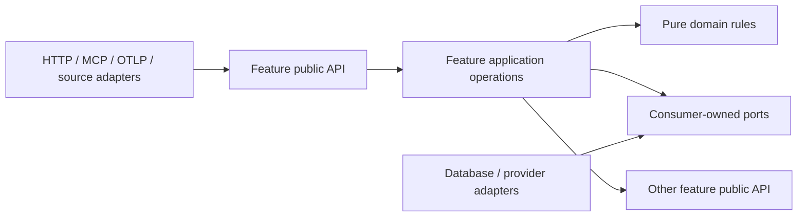
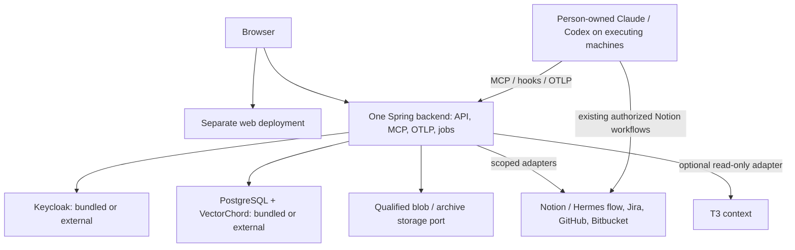

# Architecture Spine — Owl Mast V1

This spine binds independently implemented capabilities; it does not certify integrations or authorize live ingestion/deployment. [PRD](../../prds/prd-owl-mast-2026-11-05/prd.md) and [UX](../../ux-designs/ux-owl-mast-2026-11-05/EXPERIENCE.md) retain detailed behavior. The [full plan](../../epics.md) contains 19 epics, 85 stories and 340 tasks; E19 is later evolution. [AGENT-INTEGRATION.md](AGENT-INTEGRATION.md) is a planning companion, not a frozen endpoint/schema contract. Latest adopted decisions in [.memlog.md](.memlog.md) supersede its historical proposals.

## Design Paradigm

One modular Java/Spring backend uses ports and adapters. Package by feature; each feature owns its application operations, domain rules, persistence and public contracts. Framework/provider details stay in adapters. The separately deployed web client consumes public APIs. Source layout and module names below are a cold-start seed; ownership and dependency direction remain binding.

Arrows denote permitted code dependencies. Cross-feature dependencies must be acyclic; consumers cannot import another feature's internal domain, adapters or repositories. Cross-feature projections use owner APIs/events rather than unowned table joins. Shared contracts contain boundary values, not a shared mutable domain model.

## Invariants & Rules

### AD-1 — Observation and knowledge authority [ADOPTED]

- **Binds:** all; FR-14, FR-19, FR-21.
- **Prevents:** turning observation into an agent controller or replacing existing source authority.
- **Rule:** Owl Mast observes work and performs authorized knowledge operations. Jira/Git systems retain work authority; existing Hermes→Notion capture and authorized direct Claude/Codex Notion writes continue without double-saving or bulk migration. Owl Mast exposes no agent launch, execution routing, shell, merge or deployment control. Knowledge delivery does not authorize Owl Mast to execute a supplied skill. Internal processing retries remain allowed.

### AD-2 — Owned modules and data [ADOPTED]

- **Binds:** all backend capabilities; E01.
- **Prevents:** shared-table coupling and premature business microservices.
- **Rule:** Ship one backend deployable containing API and bounded background processing. Only a feature's owner mutates its records/migrations; access goes through its public operations, ports or versioned events. A shared PostgreSQL instance is not permission to bypass ownership. The bootstrap creates only its own infrastructure schemas; features add theirs when implemented. Extraction requires measured need and explicit contract/in-flight-state migration.

### AD-3 — Tenant, person and execution identities [ADOPTED]

- **Binds:** E02, E05–E10, E16–E19.
- **Prevents:** merging customer projects, people, shared accounts or machines into one identity.
- **Rule:** AISQUAD is the initial tenant; Syntelligence and Movesion are separately permissioned projects. Carry trusted tenant/project scope through records, jobs, indexes, caches and audit; test a second synthetic tenant. Keycloak manages individual Owl Mast accounts. External account bindings may be many-to-one and explicitly grant the same approved scope to mapped people. Every native enrollment has an individual owner; principal, source account, machine, client, enrollment and run remain distinct. Ownership is not proof of action initiation. Unattended/service-owned agents are deferred.

### AD-4 — One current-authorization boundary [ADOPTED]

- **Binds:** all disclosure and mutation; FR-17, NFR-1.
- **Prevents:** connector possession, historical access or tenant membership becoming blanket source access.
- **Rule:** The backend access module owns initial authorization behind a replaceable port; OpenFGA is not an initial service. Derive scope/purpose from validated identity/enrollment, never a payload claim alone. Recheck current tenant/project/source/recipient/use permission at each operation and side-effect boundary; unverifiable access fails closed. Apply the same policy to content, lineage, counts, graph edges, filters, receipts, archives, notifications and audit. Permission/lifecycle invalidation overrides buffered UI updates immediately; offline views disclose no new protected content, queue no publication/admin writes, and revalidate before reconnect refresh. Revocation blocks new managed access/materialization; it cannot erase external copies or revoke independently granted Notion/client access.

### AD-5 — Reactive composition and transaction scope

- **Binds:** backend requests, ingestion and jobs; E01, E04, E06.
- **Prevents:** event-loop blocking, lost security context and false cross-store atomicity.
- **Rule:** Use reactive request/work composition with explicit authorization context. Bind database scope to the actual connection and transaction; do not copy ThreadLocal-only JDBC scoping into async paths. No blocking calls on event-loop threads or detached application-service subscriptions. Isolate unavoidable blocking SDK operations behind bounded concurrency, deadlines and backpressure. WebFlux/Reactor with R2DBC is the implementation seed to qualify; pure domain rules need not depend on Reactor. External HTTP/model/storage effects do not participate in a database transaction by assumption.

### AD-6 — Durable work and successful-mutation audit [ADOPTED]

- **Binds:** all mutations/asynchronous work; E01, E06, E11, E15, E16.
- **Prevents:** accepted work/audit disappearing on restart or duplicated external effects being treated as exactly once.
- **Rule:** Commit each covered successful mutation with its required work and audit record or durable audit-publication intent atomically. Failed/denied attempts use a separate safe outcome path. PostgreSQL owns versioned work state, scoped claims, expiring leases, bounded retry/backoff and terminal outcomes; Spring scheduling only wakes processors. Completion requires current lease ownership. Processing is at least once: deduplicate effects or reconcile uncertain outcomes. Recheck authorization before dispatch/publication. No initial broker, workflow engine or separate worker service is required.

### AD-7 — Source authority, exact versions and typed lineage [ADOPTED]

- **Binds:** E03, E04, E06, E09–E12, E14, E16.
- **Prevents:** competing knowledge authorities, lost provenance and current state overwriting historical evidence.
- **Rule:** PostgreSQL owns application records, versioned Markdown and source-qualified typed relationship assertions. Preserve external Notion/Git ownership. Skill versions include complete manifests, files and checksums; larger/binary payloads use the qualified blob port. VectorChord indexes rebuildable, exact-version-bound embeddings; pgvector is allowed only as its required type/operator dependency, not its native indexes. Preserve derived-from, supersedes, validated-by, published-as, delivered-to and used-in relations with available actor/policy/basis and source/recorded times. Corrections/retractions append links; missing lineage remains explicit. Archive and lifecycle changes preserve stable identities.

### AD-8 — Native integrations and independent evidence contracts [ADOPTED]

- **Binds:** E04–E08, E12, E14, E17, E18.
- **Prevents:** making T3 a required telemetry gateway or equating retrieval with execution/use.
- **Rule:** Native Claude/Codex on executing machines are first-class both standalone and T3-hosted. Authenticated MCP knowledge/semantic interfaces, observational hooks/plugins and explicit OTLP ingestion live in the existing backend; outbound Spring telemetry export is not a receiver. Normalize through adapter-owned inputs into shared versioned evidence contracts. Do not require another collector. T3 adds optional read-only context. Preserve settings and secret references; qualify actual hook/export/load coverage, bounded failures and offline behavior. Availability, retrieval, delivery, native loading, observed application and human-verified reuse are separate facts.

### AD-9 — Client-led approved-default discovery and load [ADOPTED]

- **Binds:** E03, E04, E07, E08, E11; A-1.
- **Prevents:** context bloat, candidate bypass through direct IDs and automatic approval of captured text.
- **Rule:** Agents request bounded discovery summaries/metadata, then explicitly load selected exact-version content/packages. Ordinary knowledge delivery includes validated/approved guidance. An explicit candidate-inclusion feature defaults off and retains validation/provenance/conflict labels; it never overrides access or lifecycle restrictions. Apply that choice to search, loads, direct IDs and managed caches. Do not inject full lessons/history on startup, turns, knowledge changes or work updates. Work-update push is separate. Automatic validation remains supported; no universal human approval is imposed. Raw capture/archive is evidence, not approved guidance.

### AD-10 — Full capture, retained archive and preserved knowledge [ADOPTED]

- **Binds:** E02, E03, E06–E08, E16, E18; A-3.
- **Prevents:** losing conversations through a deletion TTL or expiring curated knowledge with raw content.
- **Rule:** Default capture includes prompts, responses and tool arguments/results; project administrators can disable/narrow it. Filter secrets and unauthorized content before persistence and downstream processing, with explicit missing/truncated/redacted coverage. After 30 active days, archive conversation/tool content under current permissions, preserving discovery, provenance and work/knowledge links. No automatic archive purge was chosen; curated skills/memories/lessons do not expire under this window. Retain a readable copy until durable archive integrity/readback and locator publication succeed; transitions recover idempotently. Actual collection/destination permissions and recorded retention/removal/derivative-propagation policy for every collected record class gate live ingestion.

### AD-11 — Exact publication and mode changes [ADOPTED]

- **Binds:** E03, E04, E11, E15; A-4.
- **Prevents:** stale approval, restricted provenance leakage and disabling promotion silently deleting publications.
- **Rule:** Company publication is a separately versioned, audience-bound operation within the source knowledge's owning tenant, with restricted origin lineage. Cross-project reuse never implies cross-tenant sharing; publication/audience identifiers and recipient checks remain tenant-bound. Automatic mode is preferred after policy/audience configuration; manual mode requires exact-version approval; neither bypasses required use/source/safety checks. Failed/uncertain checks retain project scope. Commit atomically against current mode, policy, content, audience and permissions. Disabling blocks all new publication, including queued/in-flight automatic or manual attempts, while existing eligible publications remain available. Content/policy/audience changes invalidate stale decisions; company ownership alone grants no publication right.

### AD-12 — Withdrawal follows derivation, not usage [ADOPTED]

- **Binds:** E03, E04, E07, E08, E11, E16; A-2.
- **Prevents:** withdrawn guidance surviving in derivatives or unrelated work being withdrawn by association.
- **Rule:** Withdrawal/quarantine blocks future ordinary retrieval and managed delivery/materialization/refresh of the affected version and transitively derived/promoted versions. Candidate inclusion cannot bypass this rule. Traverse derivation/publication lineage, not merely used-in/delivered-to links. Retain permitted restricted history; republication requires fresh evaluation. Immediate eligibility guards remain effective while indexes/caches reconcile. Distinguish source ACL loss from a separately authorized safe publication's own eligibility. Do not promise recall of external session context or prevent independent native loading of already-retained copies.

### AD-13 — One evidence and disclosure basis for views

- **Binds:** E10, E12–E17; FR-4–FR-7, FR-11, FR-15–FR-17; UX-18–UX-24.
- **Prevents:** dashboards, graph/list, costs and notifications producing incompatible truths.
- **Rule:** Views consume authorized owner projections. A failed, stale or revoked connection affects its own coverage and access; healthy independently authorized sources remain available. Keep fact/inference/estimate/unknown, source/recorded time, configured/observed location and per-role/run/model/effort/session/token evidence distinct. Graph/list expose the same permitted relations with no hidden stubs. Daily Work and notifications cover authorized connected work; Focus defaults to assigned-to-me work across authorized projects using confirmed source identity mappings. These are distinct scopes. Tracker closure, checks, acceptance and deployment are separate; Plan, Design, Build, Test, Deploy and Maintain are nonlinear observed Focus stages, with unmapped work retained. Counts retain unit/period/denominator/coverage and deduplicate replay, cross-signal and parent/child overlap. Unavailable is not zero. Keep observed usage, API-equivalent estimates, subscription allocations and actual bills distinct, with class-specific permissions, currencies and the applicable pricing source/date/basis. Receipts are not useful reuse or ROI. Push defaults to each distinct eligible observed work update; reauthorize send/open, deduplicate replay, and preserve explicit opt-outs without silent digesting.

### AD-14 — Separate web deployment and few operational services [ADOPTED]

- **Binds:** E01, E02, E18, E19.
- **Prevents:** coupling UI release to the backend image or requiring an unchosen infrastructure stack.
- **Rule:** Frontend and backend have independent artifacts/images, configuration, tests and API compatibility gates; do not bundle the production UI into the backend image. Kubernetes is the deployment target. PostgreSQL/VectorChord and Keycloak are independently optional installation dependencies: disabling a bundle requires a compatible external service, not disabled functionality. Independent self-hosting needs no mandatory vendor control plane. Keep irreplaceable state outside application pods. Frontend framework, public origins/routing and browser session/auth model remain explicit gates below.

### AD-15 — Recovery restores data without restoring obsolete authority

- **Binds:** E01, E06, E11, E15, E16, E18, E19.
- **Prevents:** snapshot rollback re-exposing revoked content or repeating already-completed external effects.
- **Rule:** The POC accepts single-instance downtime and prefers PVC snapshots. Qualify CSI support, complete PostgreSQL/WAL consistency, failure-domain durability and restore access; a PVC alone is not backup. Recovery includes identity/configuration, blobs/archive payloads and metadata/lineage. Governance owns the shared recovery-quarantine state and release contract; protected reads and external-dispatch paths consume that gate. Access, Knowledge and effect owners supply reconciliation outcomes through their APIs. Keep restored disclosure and external dispatch quarantined until current authorization, knowledge eligibility and effect outcomes reconcile; only Governance releases the affected scope, failing closed when unverifiable. Show recovered-history gaps. Overlapping pods need safe claims/drain and compatible migrations. Two application pods alone do not establish database, identity, storage or host HA; no RPO/RTO is inferred.

### AD-16 — Shared engineering and verification gates [ADOPTED]

- **Binds:** all; E01, E18.
- **Prevents:** incompatible toolchains, blocking regressions and fixture-only confidence in live integrations.
- **Rule:** Use Java application code with Gradle Kotlin DSL, feature packages, functional composition and immutable values. Prefer concise records/focused Lombok; avoid unsafe blanket setters/toString/equality, but retain clear guard clauses when appropriate. CI enforces qualified formatting/static analysis, dependency/module rules and independent web/API compatibility. Adopt Testcontainers with real PostgreSQL/VectorChord extensions and selected Keycloak flows alongside unit/component tests. Exercise authorization, transaction/audit atomicity, lease/replay and recovery failures. Native-client/source and Kubernetes/storage proofs remain real qualification work; mocks/containers cannot replace live two-project acceptance.

## Consistency Conventions

| Concern | Convention |
| --- | --- |
| Identity and time | Source-qualified stable identities; display names, shared usernames and local paths are not primary identity. Retain source time, recorded time and uncertainty separately. |
| Owned contracts | Producer/owner publishes one versioned schema before consumers implement it. Share boundary values and compatibility tests, not persistence models. Exact endpoint spelling/envelopes are owned by the prerequisite stories below. |
| Errors and coverage | Safe authorization failures; explicit denied, stale, unavailable, unsupported, partial and unknown states. No protected payload in logs, error details, metrics labels or hidden-result counts. |
| Mutation and configuration | Explicit actor, scope, expected version and actual outcome; business/work/audit durability follows AD-6. Protected credential references stay outside knowledge/events. No fabricated success for external actions. |
| Projections and history | Current permission governs present and historical disclosure. Corrections link to prior evidence; derived search/views are rebuildable and never an independent authority. |

## Stack

User-selected version pins only. Other product selections are fixed by the rules; dependency/image/tool versions are qualified by E01 before use. Researched Gradle/Spring AI recommendations are not adopted pins.

| Name | Version |
| --- | --- |
| Java application language/runtime | 27 |
| Spring Boot | 4.1.2 |

## Structural Seed

The diagram fixes component boundaries, not public origins, ingress products or separate blob-service deployment. Kubernetes packaging supports a central AISQUAD POC and independent self-hosted installs. Development/CI uses synthetic isolated dependencies; live environments require the deferred data/recovery gates.

| Feature package seed | Owned data/responsibility |
| --- | --- |
| `access`, `enrollment` | Tenant/project grants, external bindings, individual client ownership and enrollment lifecycle; Keycloak owns passwords/authentication. |
| `connections` | Source namespaces, connector scopes/health/checkpoints and permissions evidence. |
| `ingestion` | Accepted source/transport receipts, canonical observation envelopes, normalization, signal temporality and capability coverage; it does not own inferred work correlations. |
| `evidence` | Canonical work/run identities and correlations; native load/application and verified-reuse assertions referencing exact Knowledge versions/receipts. Graph/list are projections of owner-issued relationships, not a second authority for knowledge lifecycle. |
| `knowledge` | Knowledge/package/evaluation/publication lifecycle and derivation/validation/publication lineage; public MCP discovery/load/package contract, delivery acknowledgments and receipt records. |
| `retrieval` | Rebuildable indexes and query implementation behind the Knowledge contract; it does not own version eligibility, receipts or source authority. |
| `usage`, `notifications` | Evidence-based measurements/attribution; preferences, eligible update dispatch and outcomes. |
| `audit`, `governance`, `jobs` | Audit/query contracts; collection/retention/archive policy and shared recovery quarantine/release coordinated through data owners; durable work infrastructure. |

## Capability → Architecture Map

| Capability / Area | Lives in | Governed by |
| --- | --- | --- |
| E01, E18 installation, engineering and acceptance | Deployment/build, jobs and owned test fixtures | AD-2, AD-5, AD-6, AD-14–AD-16 |
| E02, E05 identity, source access, native ownership | Access/enrollment | AD-3, AD-4, AD-8 |
| E03, E04, E11 knowledge, retrieval and publication | Knowledge/retrieval, source/blob adapters | AD-1, AD-4, AD-7, AD-9–AD-12 |
| E06–E09, E17 direct native/source observation; optional T3 | Connections/ingestion and client packages | AD-3–AD-8, AD-10 |
| E10, E12–E14 work, lineage, reuse, usage and views | Evidence/knowledge/usage owner projections; web | AD-4, AD-7, AD-8, AD-13 |
| E15 work-update push | Notifications and qualified delivery adapter | AD-4, AD-6, AD-13, AD-15 |
| E16 full-system audit, governance and archive | Audit/governance coordinating owner APIs | AD-4, AD-6, AD-7, AD-10, AD-12, AD-15 |
| E19 later SaaS, permissions, availability and extraction | Existing boundaries with explicit migration | AD-2–AD-4, AD-6, AD-14, AD-15 |

## Deferred

Each row has one decision owner and a consumer gate. The owner publishes the shared choice/contract once; downstream units cannot fill the gap independently. Only qualification/contract-design work assigned to an owning story by these gates may be pulled forward using documentation or synthetic fixtures, as the plan's explicit prerequisite exception permits. The owning story publishes one accepted contract before dependent implementation; this does not waive production implementation prerequisites or complete the story. These gates do not reopen adopted product policies or remove planned features.

| Decision or qualification | Single owning story | Must be resolved before |
| --- | --- | --- |
| Gradle wrapper, JDK distribution/patch, reactive persistence baseline, Lombok/formatter/analyzers, Testcontainers and optional module-library pins; validate Java 27/Boot compatibility. | [OM-01.01](../../epics/owl-mast-2026-11-05/epic-01.md#om-01-01) | Backend bootstrap and shared build/test convention. |
| Installation packaging, Kubernetes/provider target, compatible PostgreSQL/VectorChord/required-extension/Keycloak images, resource/storage and external-service configuration. If sharing PostgreSQL, use separate logical databases/principals. | [OM-01.02](../../epics/owl-mast-2026-11-05/epic-01.md#om-01-02) | Deployment manifests and bundled/external installation reliance. |
| Frontend framework/starter and pins, common web/API error/compatibility contracts. React/TypeScript/Vite remains a proposed seed. | [OM-01.04](../../epics/owl-mast-2026-11-05/epic-01.md#om-01-04) | Frontend bootstrap and feature UI consumers. |
| Browser origins/routing, Keycloak realm/client/account flows, browser OAuth/session ownership, persistence/lifetime and CSRF/CORS/proxy behavior. No session store selected. | [OM-02.01](../../epics/owl-mast-2026-11-05/epic-02.md#om-02-01) | Authenticated browser flow and production routing. |
| Native enrollment credential/delegation, purpose scopes, refresh/revocation, exporter compatibility and shared-machine credential isolation. Browser and enrollment lifetimes are independent. | [OM-05.02](../../epics/owl-mast-2026-11-05/epic-05.md#om-05-02) | Issuing native credentials or implementing consumer credential assumptions. |
| Keycloak/native MCP OAuth discovery, registration and audience interoperability; server starter/version. | [OM-04.03](../../epics/owl-mast-2026-11-05/epic-04.md#om-04-03) | Claiming authenticated MCP client support; coordinate with the enrollment contract. |
| Actual customer collection rights and permitted processing destinations, including full content and AI processing. | [OM-02.05](../../epics/owl-mast-2026-11-05/epic-02.md#om-02-05) | First live ingestion or disclosure to a processing provider. |
| Complete package/blob contract, storage provider/limits and source ownership; consumers reuse its port. | [OM-03.02](../../epics/owl-mast-2026-11-05/epic-03.md#om-03-02) | Package persistence/delivery and blob-dependent consumers. |
| Existing Notion/Hermes schema, synchronization authority and permitted capture interface. | [OM-03.03](../../epics/owl-mast-2026-11-05/epic-03.md#om-03-03) | Source synchronization and continuity claims. |
| Embedding/model provider, VectorChord SQL/codec/index compatibility and bounded blocking integration where needed. Spring AI is selected only when AI is needed. | [OM-04.01](../../epics/owl-mast-2026-11-05/epic-04.md#om-04-01) | Embedding jobs or production retrieval-index creation. |
| Discovery/load/package schema, candidate-inclusion spelling and numerical response limits. | [OM-04.02](../../epics/owl-mast-2026-11-05/epic-04.md#om-04-02) | MCP/native/UI knowledge consumers choose wire behavior. |
| Durable-work and audit envelope versions, transaction adapter and common outcome/retry semantics. | [OM-01.03](../../epics/owl-mast-2026-11-05/epic-01.md#om-01-03) | Feature producers enqueue work or record mutations. |
| Supported OTLP wire encodings/compression, request/decompression limits, durable acknowledgment and backpressure. | [OM-06.02](../../epics/owl-mast-2026-11-05/epic-06.md#om-06-02) | Native exporters and receiver interoperability claims. |
| Canonical observation envelopes, message/tool pairing, ingestion deduplication and metric temporality; preserve required fields and explicit unsupported coverage. | [OM-06.03](../../epics/owl-mast-2026-11-05/epic-06.md#om-06-03) | Native/source adapters and measurement consumers implement shared semantics. |
| Canonical work/run identity mapping, correlation/relationship assertions and shared graph projections consuming the observation contract. | [OM-10.01](../../epics/owl-mast-2026-11-05/epic-10.md#om-10-01) | Downstream work/graph/attribution consumers implement shared semantics. |
| Actual Jira/Bitbucket editions, resource scopes, source ACL verification and event/reconciliation contracts. | [OM-09.01](../../epics/owl-mast-2026-11-05/epic-09.md#om-09-01) | Connector implementation estimates and live connector setup. |
| Permitted-use input owner, concrete company-publication checks and audience policy. | [OM-11.01](../../epics/owl-mast-2026-11-05/epic-11.md#om-11-01) | Live automatic/manual promotion activation. |
| Push platform/provider and actual laptop/tablet/phone support, including PWA/background constraints. | [OM-15.01](../../epics/owl-mast-2026-11-05/epic-15.md#om-15-01) | Push implementation/platform claims; no native/PWA packaging inferred. |
| Other record-class/backup retention, authorized removal and propagation policy. No archive purge or curated-knowledge expiry is inferred. | [OM-16.03](../../epics/owl-mast-2026-11-05/epic-16.md#om-16-03) | Live ingestion of the governed record classes and retention/removal mechanisms. |
| Archive backend/age clock, late-arrival handling, latency, integrity/readback and locator publication using the common blob contract. | [OM-16.06](../../epics/owl-mast-2026-11-05/epic-16.md#om-16-06) | Live 30-day archival transition. |
| Actual native/runtime/source capability matrix and numerical freshness/performance budgets. Unsupported proof remains a visible gap, not silently waived scope. | [OM-18.01](../../epics/owl-mast-2026-11-05/epic-18.md#om-18-01) | Relevant compatibility/performance acceptance. |
| Shared recovery-quarantine state, reconciliation/result contract and release authority consumed by reads, jobs and operational readiness. | [OM-16.05](../../epics/owl-mast-2026-11-05/epic-16.md#om-16-05) | Implementing recovery release/readiness or claiming restored disclosure/dispatch is safe. |
| Snapshot driver/support, consistency procedure, backup destination/failure domain/cadence, implementation and verification of OM-16.03-owned backup retention policy, and explicit RPO/RTO, including archive restore and qualification of the OM-16.05-owned permission/effect reconciliation gate. | [OM-18.02](../../epics/owl-mast-2026-11-05/epic-18.md#om-18-02) | Relying on recovery for real customer data. |
| A-5 enrollment ceiling and A-6 reuse sample selection; baseline work/acceptance evidence and outcome targets. | [OM-18.03](../../epics/owl-mast-2026-11-05/epic-18.md#om-18-03) | Owner/participant acceptance run, after enrollment trials and sample confirmation. |
| Open-source license and dependency redistribution compatibility. | [OM-18.04](../../epics/owl-mast-2026-11-05/epic-18.md#om-18-04) | Public release; internal pilot remains a separate gate. |
| Multiple active tenants and their operational onboarding. | [OM-19.01](../../epics/owl-mast-2026-11-05/epic-19.md#om-19-01) | Later SaaS rollout; scoped POC data/isolation is already required. |
| OpenFGA policy/store migration and authorization parity. | [OM-19.02](../../epics/owl-mast-2026-11-05/epic-19.md#om-19-02) | Introducing the later authorization adapter. |
| Multi-pod availability, shared-state behavior and compatible rolling upgrades. | [OM-19.03](../../epics/owl-mast-2026-11-05/epic-19.md#om-19-03) | Later availability claim, not the single-instance POC. |
| Separate services/workflow engine or additional MongoDB/Neo4j store. | [OM-19.04](../../epics/owl-mast-2026-11-05/epic-19.md#om-19-04) | Measured workload/maintenance need and explicit migration decision. |
